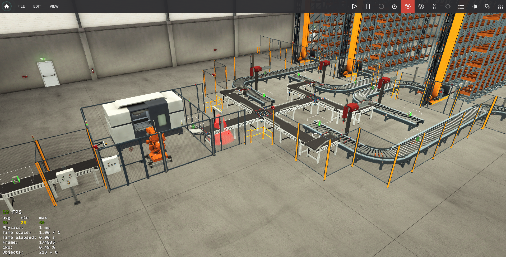

# Sorteringsverk (Advanced)

Ett komplett flöde från råmaterial till höglager, byggt i **Factory IO** och styrt med **Siemens S7-PLC** i **TIA Portal** via **PLCSIM**. Projektet gjordes under LIA 1.

Råa block bearbetas till lock (*lids*) eller bottnar (*bases*) i blått eller grönt. Kameror sorterar dem till fyra separata linjer. På varje linje lägger en pick & place-robot detaljen i en låda, och lådan körs till en staplarkran som lagrar in den i höglagret.



---

## Flöde

```
Råa block (blå/gröna)
        │  Inmatningsband
        ▼
 Bearbetningscenter ──► gör om blocket till lid eller base
        │  Utgångsband
        ▼
 Kameror: Blue Lid · Blue Base · Green Lid · Green Base
        │  Sorter 1 / Sorter 2 leder av detaljen till rätt linje
        ▼
 ┌──────────────┬──────────────┬──────────────┬──────────────┐
 │  Blue Lid    │  Blue Base   │  Green Lid   │  Green Base  │
 │  Positioner  │  Positioner  │  Positioner  │  Positioner  │
 │  Pick&Place  │  Pick&Place  │  Pick&Place  │  Pick&Place  │
 │  Rullbana    │  Rullbana    │  Rullbana    │  Rullbana    │
 │  Staplarkran │  Staplarkran │  Staplarkran │  Staplarkran │
 └──────────────┴──────────────┴──────────────┴──────────────┘
```

---

## Stationer

### 1. Råmaterial och bearbetning

- Start-knappen startar inmatningsbandet. Bandet stannar när blocket passerat *Stop Entrance Belt Sensor* (negativ flank).
- Bearbetningscentret startas när ett block väntar och maskinen inte är upptagen (*Is Busy*). Inga nya block matas in medan ett block väntar.
- **Hängningsskydd:** om maskinen står öppen utan att bearbeta (*Progress* = 0) i 3 s medan ett block väntar, körs inmatningsbandet en kort puls på 1,5 s för att skjuta in blocket. Pulsen avbryts direkt om bearbetningen startar eller maskinen stänger.
- När *Write Sensor* ser en färdig detalj sparas det, och utgångsbandet startar mot sorteringen.

### 2. Sortering med kameror

- Fyra kameror (*Blue Lid*, *Blue Base*, *Green Lid*, *Green Base*) sätter var sin valflagga i en gemensam DB (`internalVariables`). Flaggan är detaljens "minne" fram till avvikaren.
- **Sorter 1** leder av lock: *Blue Lid* åt ena hållet och *Green Lid* åt det andra.
- **Sorter 2** leder av bottnar på samma sätt: *Blue Base* och *Green Base*. Bottnarna går rakt igenom Sorter 1 och styrs vid Sorter 2 av en egen stegsekvens.
- När detaljen passerat avvikaren (*Path*-givaren på respektive linje) återställs avvikaren och valflaggan, och linjens band startar.

### 3. Pick & place

Varje linje har en tvåaxlig robot (X och Z) som positioneras med **analoga setpoints 0–10 V**. I PLC:n motsvarar det Int 0–27648, där 0 (0 V) är hemläget och 27648 (10 V) är längst ut. Analoga positionsgivare skickar tillbaka läget i samma skala, så att setpoint och ärvärde kan jämföras direkt.

| Steg | Gör | Klart när |
|---|---|---|
| Centrera | Positioneraren klämmer detaljen | *Clamp Sensor* |
| Ut | X körs till plockpositionen | X-läget framme |
| Ner | Z sänks | Z-läget nere |
| Grip | Gripdonet aktiveras | *Grab Sensor* |
| Upp | Z till 0 | Z uppe |
| Hem | X till hemläge | X hemma och ingen låda vid stoppet |
| Hämta låda | Rulle 1 kör fram en tom låda | *Stop Roller Sensor* |
| Lägg i | Z sänks helt (27648) och släpper | Z nere |
| Skicka | Z upp, rullbanan kör lådan mot kranen | Efterkörningstid löpt ut |

### 4. Staplarkran och höglager

- Lastbandet stannar när en låda står vid kranen (*Loader Sensor*).
- Kranen tar lådan med gaffeln, lyfter, kör till nästa lediga plats och lämnar lådan till **vänster eller höger** i hyllan. Därefter körs kranen hem (position 55).
- Platserna fylls i ordning: varje position fylls först på vänster sida, sedan höger, och sedan går kranen vidare till nästa position.
- **54 positioner × 2 sidor = 108 lådor per linje.** När lagret är fullt sätts `storageFULL` och anläggningen pausas.
- De gröna linjernas kranar är spegelvända mot de blå.

---

## Driftlägen och säkerhet

| Funktion | Beteende |
|---|---|
| **Reset** (`resetALL`, Stop-knappen) | Alla utgångar och sekvenser nollställs, kranarna skickas hem och lagerräknaren börjar om |
| **Nödstopp** | Nödstoppet på panelen (NC) låses in och stoppar alla band, rullar och avvikare. Sekvenssteg och status behålls. Kvitteras med Start när nödstoppet är återställt, och anläggningen fortsätter där den var |
| **Säkerhetsdörrar 1–6** | Öppnas en dörr stoppas inmatningen. Varje linje stoppas dessutom av sin egen dörr |
| **Paus** | Aktiveras när kön av lock är full (*Conv Roller Sensor*) eller lagret är fullt. Släpps med Start eller när kön tömts |

**Paus utan att tappa läget:** när pausen börjar sparas varje utgångs läge och stängs av. När pausen slutar återställs utgångarna exakt som de var. Den sista rullen och lastbandet fortsätter att gå under en vanlig paus så att lådor som redan är på väg hinner fram till kranen. Vid fullt lager stoppas även de.

Flanken från *Write Sensor* fångas även under nödstopp, så att ingen detalj glöms bort.

---

## Programstruktur

| Block | Innehåll |
|---|---|
| `Stop - Nödstopp` | Inlåsning och kvittering av nödstopp, reset via Stop-knappen |
| `rawMaterialToBase` | Inmatning, bearbetningscenter, hängningsskydd, kameror, paus |
| `blueLidPath` | Sorter 1, pick & place, rullbana, staplarkran |
| `blueBasePath` | Sorter 2, pick & place, rullbana, staplarkran |
| `greenLidPath` | Som blueLidPath, spegelvänd kran |
| `greenBasePath` | Som blueBasePath, spegelvänd kran |
| `internalVariables` (DB) | Valflaggor från kamerorna, paus, nödstopp, reset, lagret fullt |

Varje station har sina sekvenser i CASE-satser: en för pick & place, en för kranen och, för Blue Base, en för sorteringen.

---

## Problem som löstes

- **Bearbetningscentret hängde sig** med öppen lucka och blocket utanför. Löst med en tidsövervakning som ger inmatningsbandet en kort extra puls.
- **Detaljerna tappade bort sin typ** mellan kamera och avvikare. Löst med en valflagga per typ som sätts av kameran och nollställs först när detaljen passerat avvikaren.
- **Paus gjorde att band startade fel** när de släpptes. Löst genom att spara alla utgångars läge vid pausens början och återställa dem efteråt.
- **Lådor fastnade halvvägs** när anläggningen pausades. Löst genom att låta den sista rullen och lastbandet gå klart under paus.

---

## Vidareutveckling

- Styra kranen på dess egna lägesgivare i stället för fasta tider, så att den blir snabbare och säkrare om något tar längre tid än väntat.
- Göra en gemensam FB för de fyra linjerna med typ och kranriktning som parametrar, i stället för fyra nästan likadana block.
- Spara lagerläget (nästa lediga plats) så att det överlever en omstart och kan visas på en HMI.

---

## Filstruktur

```
blocks/      PLC-block som text (SIMATIC SD)
tags/        Taggtabeller (CSV)
hardware.md  Hårdvarukonfiguration
```

## Verktyg

- Factory IO 2.5.10 (Siemens Edition)
- TIA Portal V21, SCL
- S7-1200 (CPU 1211C) i S7-PLCSIM

> Endast testat i simulering. Eventuella `Test_*`-block som skriver till ingångar ska tas bort före nedladdning till en riktig PLC.
